# Coaching Management & Learning Platform

A comprehensive coaching and learning platform designed to help coaching institutes manage courses, batches, study materials, online tests, homework, mentorship sessions, group sessions, and student performance in one place.

The platform combines a structured learning experience with an advanced JEE-level test engine, performance analytics, live learning features, and an installable Progressive Web App (PWA).

## Features

### 1. Course & Learning Management

- **Structured Courses:** Organize learning materials into chapters and topics.
- **Video Lectures:** Provide recorded video lessons for students.
- **PDF Study Materials:** Upload and access notes and other learning resources.
- **Practice Sets:** Create topic-wise practice tests to reinforce learning.
- **Previous-Year Question Papers:** Provide previous-year papers for exam preparation.
- **Batch Management:** Organize students, courses, and subjects into batches.
- **Flexible Enrollment:** Allow students to access individual courses or complete batches.

### 2. Advanced JEE Test Engine

A test-taking experience designed for competitive exam preparation, with detailed question-level tracking and analysis.

- **Multiple Question Types:** Support single-select, multiple-select, numerical-answer, and match-the-pairs questions.
- **Question Navigation:** Move between questions using a question navigator.
- **Time Tracking:** Track the time spent on individual questions.
- **Scoring & Evaluation:** Calculate marks based on the configured marking scheme, including partial marking where applicable.
- **Test Summary:** Review test results and performance after submission.
- **Question-Level Analytics:** Analyze responses, marks, and time spent on each question.
- **Performance Comparison:** Compare question-level performance with the test topper.

### 3. Homework Management

- Assign homework and practice activities to students.
- Track homework progress and completion.
- Help teachers monitor student participation and academic progress.

### 4. Live Classes & Mentorship

- **Live Classes:** Support online classroom sessions.
- **One-to-One Mentorship:** Facilitate individual mentorship sessions.
- **Group Sessions:** Organize group discussions and learning sessions.

### 5. Notifications

- **In-App Notifications:** Keep students informed about relevant updates.
- **Push Notifications:** Deliver notifications through supported devices and browsers.
- Notify students about important learning activities and platform updates.

### 6. Student Performance Analytics

- Track student performance across tests.
- View detailed question-level performance.
- Analyze time spent on individual questions.
- Review test scores and assessment summaries.
- Help teachers identify areas where students may need additional support.

### 7. Administration & Teaching Tools

- **Admin Dashboard:** Manage platform data and administrative activities.
- **Teacher Dashboard:** Support teaching and student-monitoring workflows.
- **Content Management:** Manage courses, chapters, topics, study materials, and practice sets.
- **Batch Management:** Organize courses and students for structured learning.
- **Marketing Pages:** Present the platform and its batches to prospective students.

### 8. Progressive Web App (PWA)

- Installable on supported devices.
- App-like experience through a web browser.
- Push notification support on compatible devices and browsers.
- Convenient access without requiring installation through a traditional app store.

## Screenshots

### Admin Dashboard

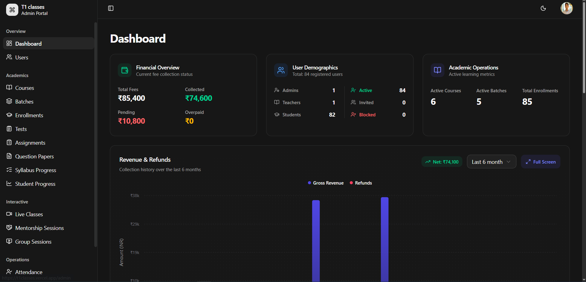

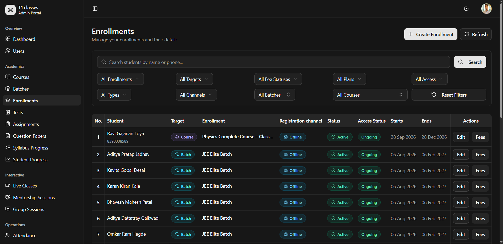

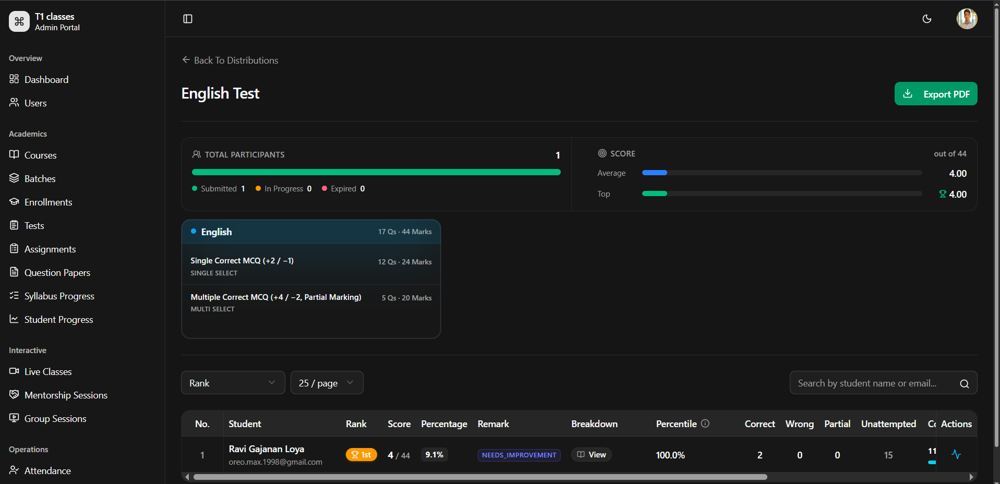

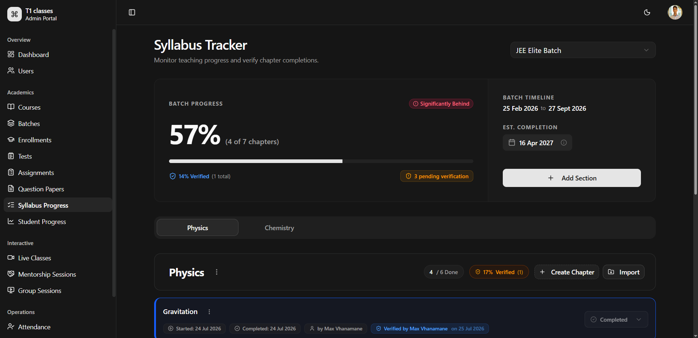

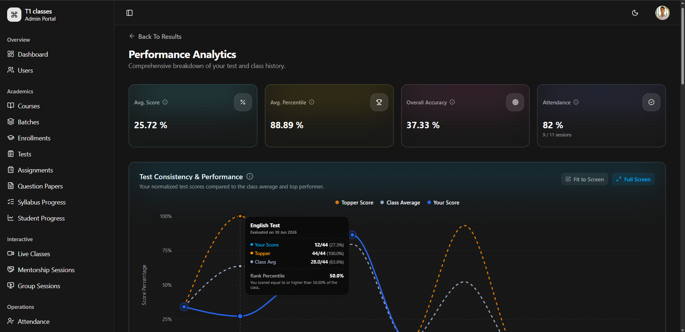

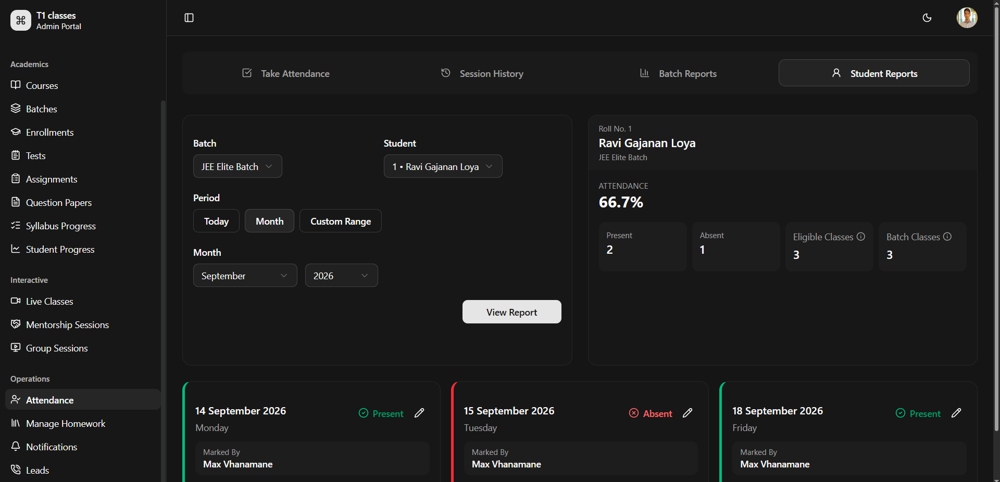

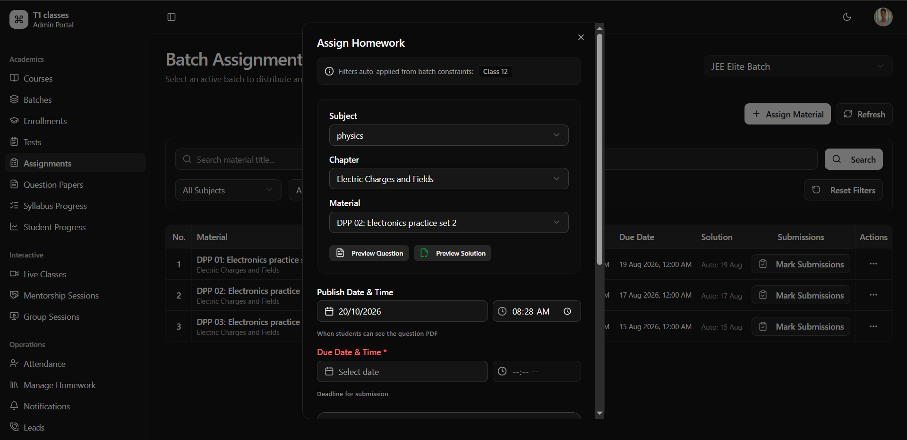

### Student Learning Experience

### Tests & Assessments

#### JEE Test Interface

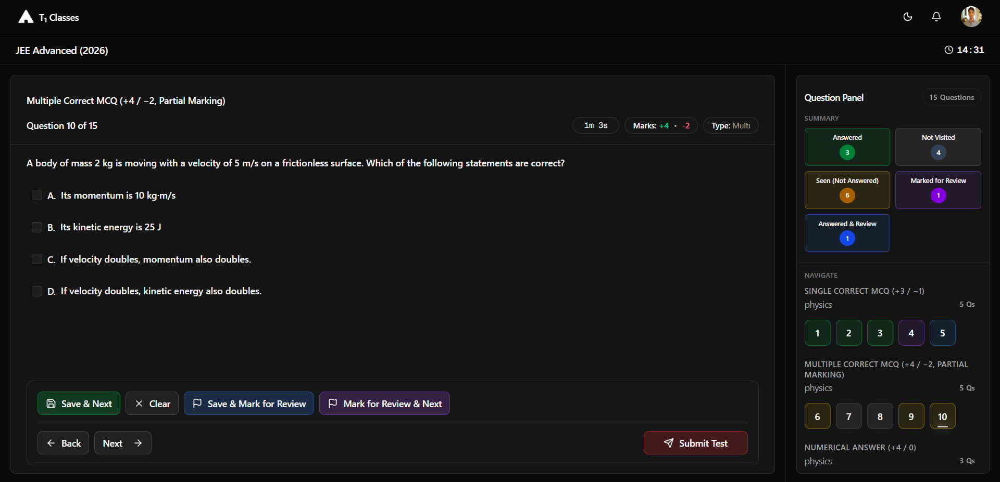

#### Test Summary

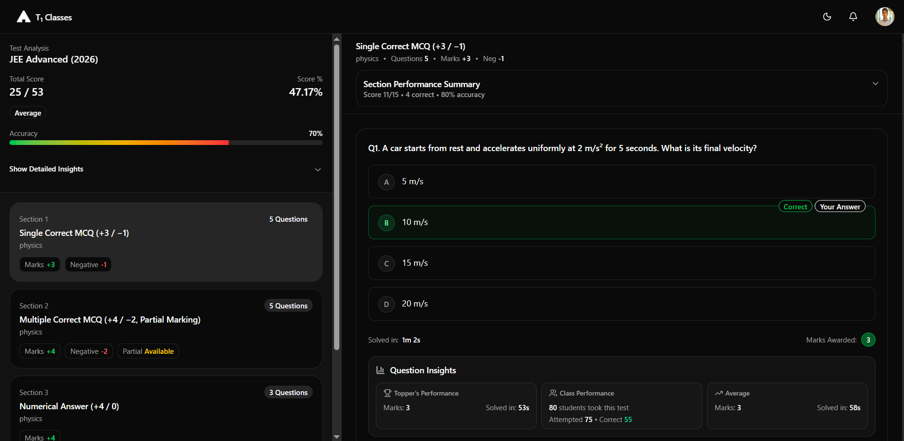

#### Course Structure

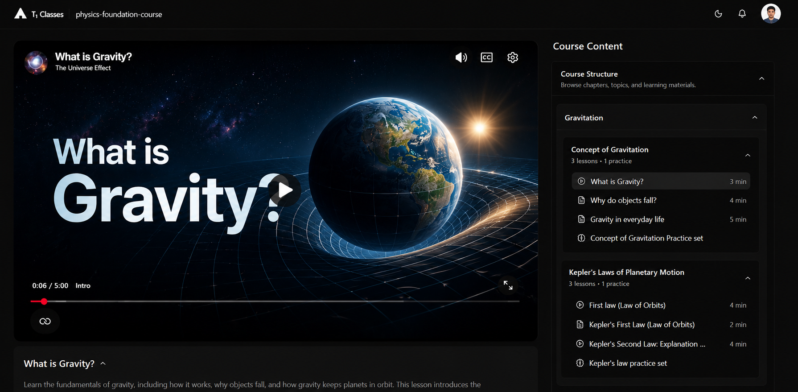

#### Batch Interface

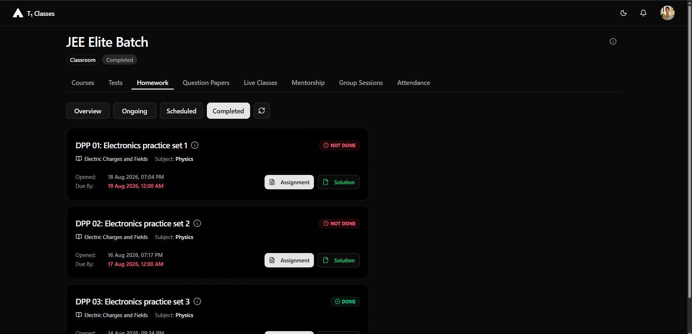

#### PDF Study Materials

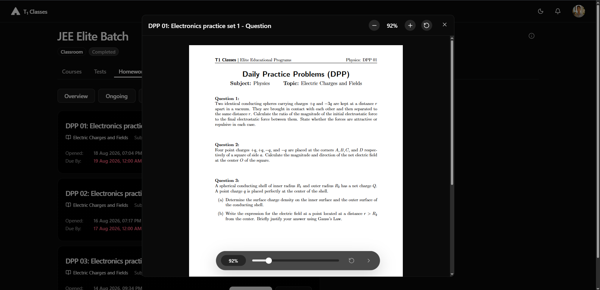

#### Login Page

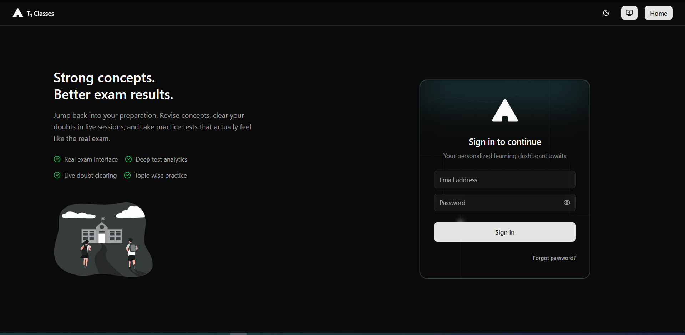

### Student Performance & Analytics

#### Student Performance — View 1

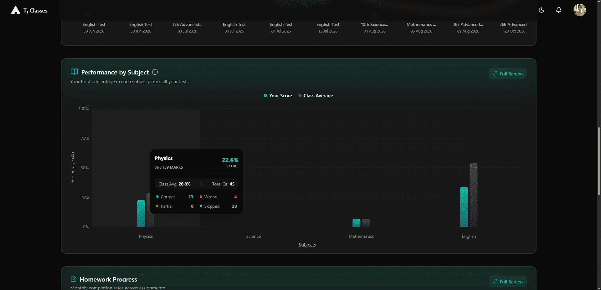

#### Student Performance — View 2

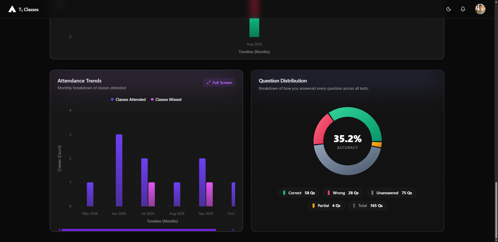

#### Student Performance for Teachers

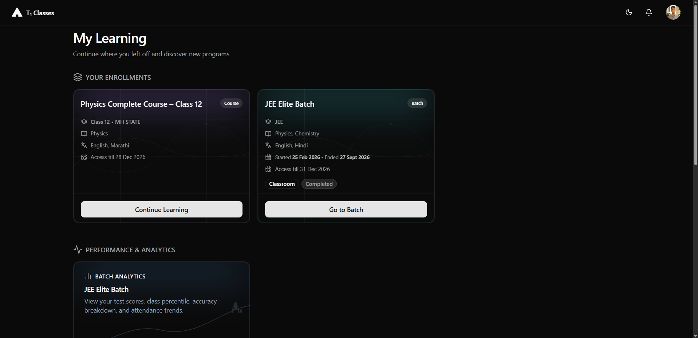

### Marketing Pages

#### Main Marketing Page

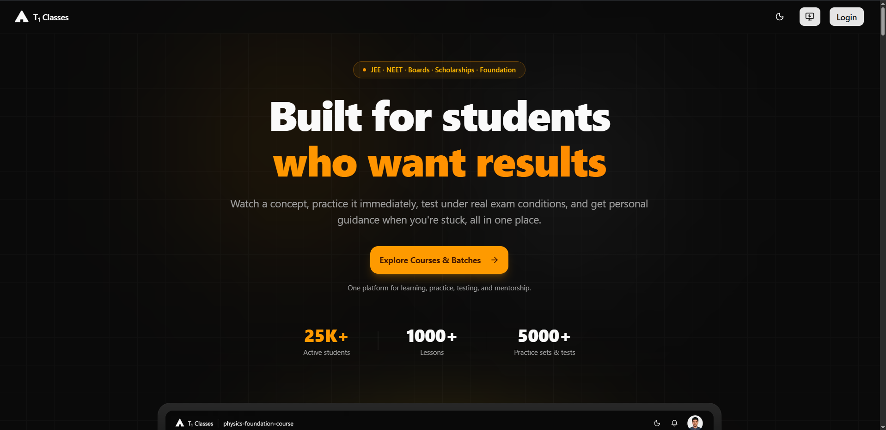

#### Batch Marketing Page

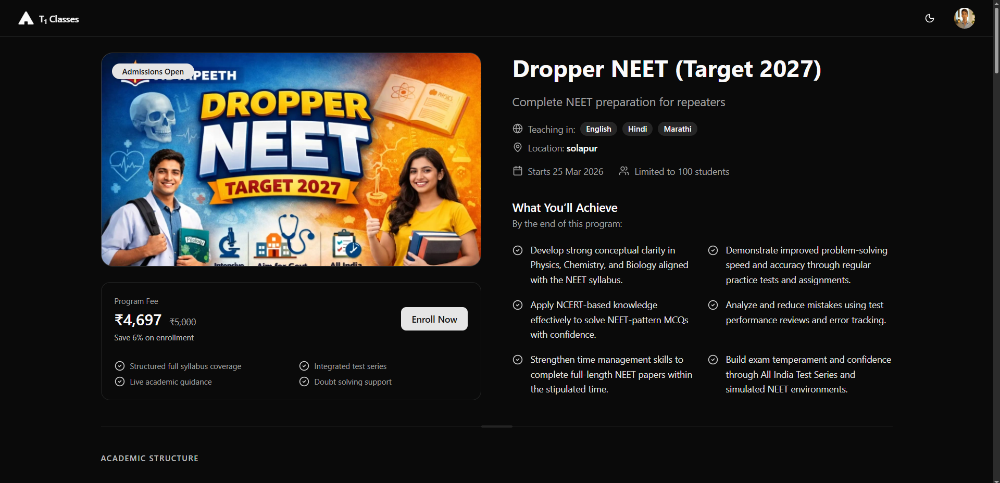

### Light Mode

#### Admin Panel — Light Theme

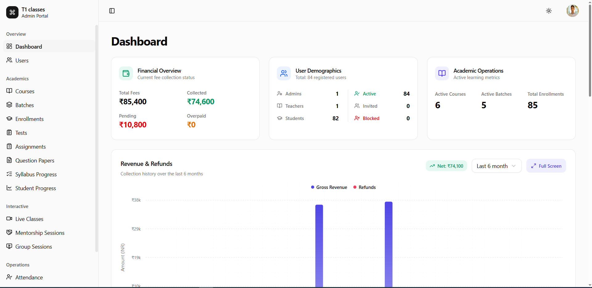

## Tech Stack

- **Frontend:** Next.js 16, React 19, TypeScript, Tailwind CSS 4, shadcn/ui
- **Backend:** Next.js (App Router, server-side logic, and API routes)
- **Database & Authentication:** Supabase
- **Data Fetching & State Management:** TanStack Query (React Query)
- **Rich Text Editor:** Tiptap
- **Real-Time Communication:** VideoSDK, Agora
- **File Storage:** Cloudflare R2
- **Notifications:** Firebase Cloud Messaging (FCM)
- **Forms & Validation:** React Hook Form, Zod
- **UI Components & Icons:** Radix UI, Lucide React
- **Charts & Analytics:** Recharts
- **PDF Generation & Rendering:** jsPDF, React PDF
- **Application Type:** Progressive Web App (PWA)

## Project Highlights

- Combines course delivery, test preparation, homework, mentorship, and student performance tracking in one platform.
- Includes an advanced test engine designed for competitive exam preparation.
- Provides detailed question-level analytics, including time tracking and marks analysis.
- Supports structured learning through courses, chapters, topics, and batches.
- Offers an installable PWA experience with notification support.

---

_Developed as a freelance project for a coaching institute._
